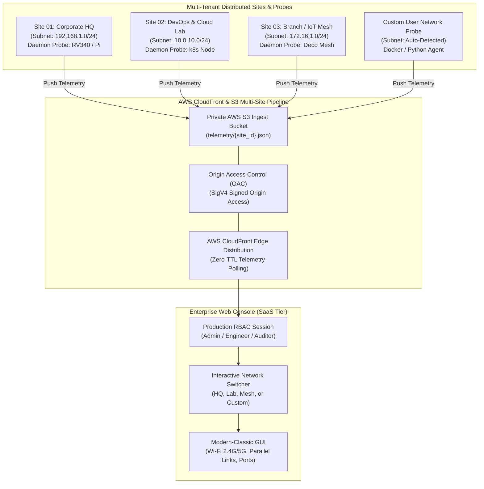

# NET_DISCOVERY_v1.2 // Production Multi-Tenant Network Telemetry Platform


An automated, production-grade network telemetry SaaS and monitoring platform. Any user who logs in can view registered network sites, switch between different office/cloud subnets, or connect their own local network probe (Raspberry Pi, Linux server, Docker, or laptop) to discover all Wi-Fi and LAN devices in real time.

---

## 📑 Multi-Tenant Architecture Overview

Because AWS CloudFront and public cloud resources cannot directly probe private RFC 1918 subnets (e.g. `192.168.1.0/24`, `10.0.0.0/8`, `172.16.0.0/12`), NetDiscovery uses a **Hybrid Multi-Tenant Edge-Collector Architecture**:



---

## 🚀 Key Features

### 1. Multi-Tenant Network Site Switcher
- **Any Network Support**: Not hardcoded to any single network or subnet. Switch between multiple registered sites (Corporate HQ, DevOps Cloud Lab, IoT Mesh, or live local probe).
- **Auto-Subnet Detection**: Daemon probes auto-detect default gateways, subnet masks (`/24`, `/16`), and active wireless interfaces on any OS.
- **Probe Onboarding Wizard**: Anyone logging into the console can connect their network in 60 seconds with copy-paste commands for Docker, Linux/Raspberry Pi, or Python.
- **Instant JSON Ingest**: Direct drag-and-drop or file upload to inspect any network's `devices.json` file on the fly.

### 2. Enterprise Authentication & Role-Based Access Control (RBAC)
- **Multi-Persona Login**: Fast 1-click persona switching (Vedant Singh `Admin`, Sarah Lin `Senior Engineer`, Alex Reed `Security Auditor`) or custom work email login.
- **Session Persistence**: Secure session storage across page reloads.
- **Probe Secret Management**: Ingest Bearer Token viewer with 1-click clipboard copy.

### 3. Wi-Fi Band & Multi-Link Parallel Connection Telemetry
- **2.4 GHz vs 5 GHz vs 6 GHz Badging**: Color-coded badges indicating frequency bands.
- **Parallel Multi-Link (2.4G + 5G Active)**: Identifies dual-band routers, mesh access points, and modern MLO devices associated across multiple bands simultaneously.
- **Band Filter Chips**: 1-click toolbar filters for `Dual-Band`, `5 GHz`, and `2.4 GHz`.
- **Deduplication Engine**: Filters out broadcast phantom IPs (`.255`), multicast addresses, and hardware collision records.
  - `Gateway / Router`
  - `Workstation PC / Laptop`
  - `Mobile Device`
  - `Smart Home / IoT`
  - `Network Storage / NAS`
  - `Network Printer`
  - `Server / Infrastructure`
- **State Persistence**: Tracks `first_seen` and `last_seen` timestamps across cycles and flags nodes as `Active`, `Idle`, or `Offline`.
- **Atomic File Writing**: Safeguards file integrity using temp files and atomic rename operations.

### 2. High-End Responsive Telemetry Console (`index.html`)
- **Modern-Classic Aesthetics**: Dark slate/navy/carbon palette with radar animation, glowing status beacons, and crisp developer typography (`JetBrains Mono` + `Inter`).
- **Real-Time KPI Bar**: Total devices, online devices, gateway IP, and a ticking scan timer.
- **Dual Display Modes**:
  - **Card View**: Clean cards with copy-to-clipboard for IP & MAC, vendor chips, latency tags, open port badges, and inspect buttons.
  - **Dense Table View**: Monospace developer table with sortable columns (IP, Hostname, Vendor, Latency).
- **Search & Filter Engine**: Live instant search across IP, MAC, vendor, hostname, or open ports, plus filter chips (`All`, `Online`, `Idle`, `Offline`, `IoT`, `Mobile`, `Workstation`, `Gateway`).
- **Deep Telemetry Inspector Modal**: Detailed node inspector with port service mapping, timestamps, and copyable raw JSON.
- **Offline / Standalone Resilience**: Seamless fallback to rich sample dataset if network fails or when opening directly as a local file.
- **Data Export**: 1-click export of the network topology to structured JSON or CSV.
- **Project Maintainer Showcase**: Dedicated card featuring **Vedant Singh** (Network Automation & Systems Engineer) with links to portfolio (`https://www.sshconnect.space/`), GitHub, and LinkedIn.

---

## 🛠️ Installation & Quickstart

### Prerequisites
- Python 3.8+
- (Optional) `boto3` for AWS S3 direct sync

### 1. Test the Scanner Daemon Locally
```bash
# Clone or navigate to the project directory
cd /path/to/networkfinder

# Run a single discovery sweep
python3 daemon/scanner.py --once

# Or run continuously every 30 seconds
python3 daemon/scanner.py --interval 30
```

### 2. Run with Automated S3 CloudFront Sync
```bash
# Configure your AWS credentials
aws configure

# Run the scanner with automatic push to your S3 bucket
python3 daemon/scanner.py --interval 30 --s3-bucket my-telemetry-bucket-name
```

### 3. Run as a Systemd Service (Raspberry Pi / Linux Server)
```bash
# Copy the service file
sudo cp daemon/networkfinder.service /etc/systemd/system/

# Edit your bucket name in the service unit
sudo nano /etc/systemd/system/networkfinder.service

# Enable and start the service
sudo systemctl daemon-reload
sudo systemctl enable --now networkfinder
sudo systemctl status networkfinder
```

---

## ☁️ AWS CloudFront & S3 Deployment

### Option A: 1-Click Provisioning via Terraform
```bash
cd terraform
terraform init
terraform apply
```
This automatically provisions:
1. Private S3 bucket with CORS configuration.
2. CloudFront Distribution with Origin Access Control (OAC).
3. Optimized Cache Behaviors:
   - `/devices.json`: Zero cache (`min_ttl = 0`, `max_ttl = 5`, `Cache-Control: no-cache`).
   - Static Web Assets: Edge cached for 24h.
4. Dedicated IAM user with least-privilege `s3:PutObject` on `devices.json`.

### Option B: AWS CLI Deployment
```bash
# Run the deployment script
bash aws/deploy_aws.sh my-telemetry-bucket us-east-1

# Or on Windows PowerShell:
.\aws\deploy_aws.ps1 -BucketName "my-telemetry-bucket" -Region "us-east-1"
```

---

## 🛡️ Cache Invalidation & Stale Data Prevention

To ensure the web app **never** displays stale network states while hosted behind CloudFront:
1. **S3 Metadata Headers**: `sync_s3.py` sets:
   ```http
   Cache-Control: no-cache, no-store, must-revalidate, max-age=0
   Content-Type: application/json
   ```
2. **CloudFront Cache Behavior**:
   - Path Pattern: `/devices.json`
   - Cache Policy: `Managed-CachingDisabled` or `TTL = 0`
   - Query String Forwarding: Enabled (`_t=timestamp` appended on each fetch).

---

## 👨‍💻 Project Maintainer

**Vedant Singh**  
*Network Automation & Systems Engineer*  
- 🌐 **Portfolio**: [sshconnect.space](https://www.sshconnect.space/)  
- 💼 **LinkedIn**: [LinkedIn Profile](https://linkedin.com)  
- 🐙 **GitHub**: [GitHub Profile](https://github.com)  

---

## 📄 License
MIT License. Open-source network discovery and telemetry framework.
