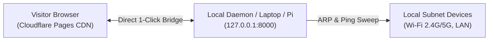

# 🌐 Deploying NetDiscovery on Cloudflare Pages (100% FREE Tier)

> **Yes! NetDiscovery runs flawlessly on Cloudflare Pages for $0/month forever.**
> Cloudflare Pages includes **unlimited bandwidth**, **unlimited requests**, a global **Anycast CDN**, free **automated SSL**, and continuous Git deployments with zero hosting fees.

---

## 🎯 3 Zero-Cost Architectures on Cloudflare

### Architecture 1: Cloudflare Pages + Browser Agent Bridge (Simplest & 100% Free)
- **Frontend**: `index.html` + static assets hosted on Cloudflare Pages (`https://<project-name>.pages.dev`).
- **Data Ingest**: Any user running the local daemon probe has their telemetry served on `http://127.0.0.1:8000/devices.json`.
- **How It Works**:
  1. Any user opens your Cloudflare Pages URL on their browser.
  2. The browser automatically probes their local machine (`http://127.0.0.1:8000/devices.json`) or lets them click **"Auto-Detect My Network"**.
  3. Their local Wi-Fi & LAN devices instantly appear on the dashboard!
  4. **Cost**: **$0.00 / month forever**.



---

### Architecture 2: Cloudflare Pages + Cloudflare R2 Object Storage (100% Free Tier)
- **Frontend**: Hosted on Cloudflare Pages.
- **Backend Storage**: Cloudflare R2 (S3-compatible object storage).
- **Free Allowance**:
  - **10 GB** storage per month (NetDiscovery telemetry is only ~5 KB).
  - **1,000,000 Class A operations** (writes/uploads) per month.
  - **10,000,000 Class B operations** (reads/downloads) per month.
  - **$0 Egress Fees** (unlike AWS, Cloudflare never charges for egress bandwidth!).
- **How Daemon Syncs**:
  In `daemon/sync_s3.py`, simply pass the Cloudflare R2 endpoint URL:
  ```bash
  python daemon/sync_s3.py \
    --file devices.json \
    --bucket my-netdiscovery-bucket \
    --endpoint-url "https://<CLOUDFLARE_ACCOUNT_ID>.r2.cloudflarestorage.com"
  ```

---

### Architecture 3: Git-Integrated Deployment (GitHub -> Cloudflare Pages)
- Connect your GitHub repo to Cloudflare Pages.
- Whenever you push updates to `main`, Cloudflare automatically builds and deploys your site to edge nodes in 300+ cities worldwide in ~15 seconds.

---

## 🚀 60-Second Quickstart: Deploy to Cloudflare Pages

### Option A: Using Wrangler CLI (No Git required)
```bash
# 1. Install Wrangler (Cloudflare CLI) if not already installed
npm install -g wrangler

# 2. Login to your free Cloudflare account
wrangler login

# 3. Deploy the current directory to Cloudflare Pages
wrangler pages deploy . --project-name=netdiscovery-cloud

# Output will provide your live URL:
# ✨ Deployment complete! Take a peek over at https://netdiscovery-cloud.pages.dev
```

### Option B: Cloudflare Web Dashboard (Drag-and-Drop or Git)
1. Log in to [Cloudflare Dashboard](https://dash.cloudflare.com/) and go to **Workers & Pages**.
2. Click **Create Application** -> **Pages**.
3. Select:
   - **Connect to Git** (select this repository), or
   - **Direct Upload** (drag & drop the `d:\networkfinder` folder).
4. Set:
   - **Framework preset**: `None`
   - **Build output directory**: `.` (root directory)
5. Click **Save and Deploy**. Your console is instantly live with custom domain support and SSL!

---

## ⚡ Cross-Origin Resource Sharing (CORS) for Local Probe
To allow your Cloudflare Pages dashboard (`https://*.pages.dev`) to fetch `devices.json` from your local machine, the local server handles CORS automatically when launched with:
```powershell
# Windows
powershell -ExecutionPolicy Bypass -File .\run_local_probe.ps1
```
```bash
# Linux / macOS
chmod +x run_local_probe.sh && ./run_local_probe.sh
```

---

## 📊 Summary Comparison: AWS vs Cloudflare Free Tier

| Feature | AWS (S3 + CloudFront) | Cloudflare Pages + R2 |
| :--- | :--- | :--- |
| **Monthly Cost** | Free Tier for 12 mos (~$0.50/mo after) | **100% Free Forever ($0.00)** |
| **Bandwidth / Egress** | 1 TB/month free | **Unlimited Bandwidth (0 Egress Fees)** |
| **Custom Domains** | Included via Route 53 / ACM | **Included with free 1-click SSL** |
| **Edge Cache Speed** | ~450+ CloudFront PoPs | ~330+ Anycast Data Centers |
| **Setup Complexity** | IAM roles, OAC, CloudFront distribution | **1 Command (`wrangler pages deploy`)** |

*Maintainer: Vedant Singh ([https://www.sshconnect.space/](https://www.sshconnect.space/))*
